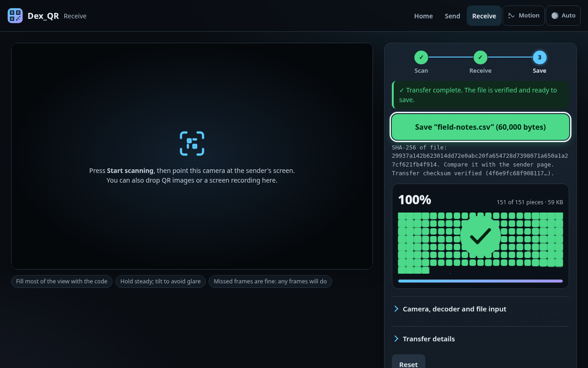
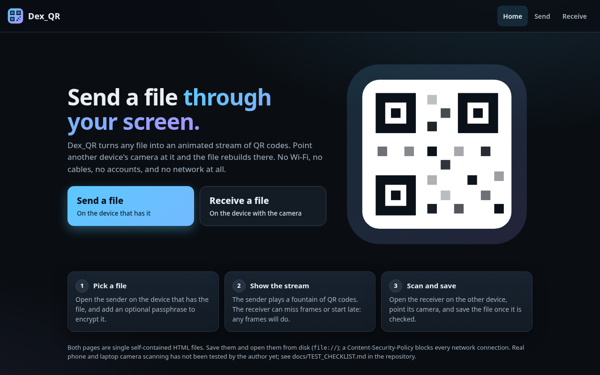
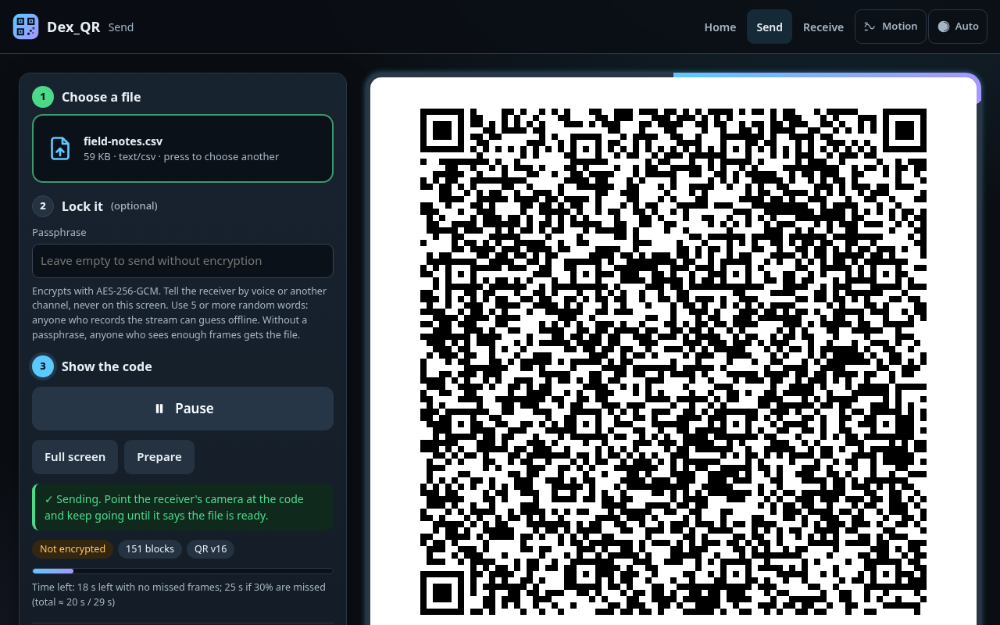
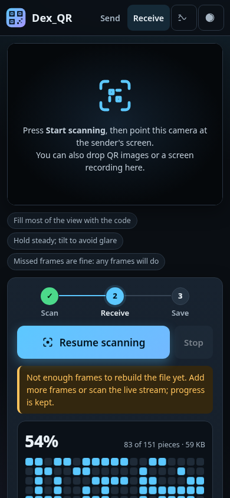

# Dex_QR

Dex_QR moves a file from one device to another as a stream of animated QR codes. It needs no network, no server, no pairing and no app install. The sender page shows an endless **LT fountain code** stream (robust soliton distribution). The receiver page scans it with the camera and rebuilds the file once it has enough independent frames. Any frames will do, in any order, starting anywhere in the stream. Text-like files are compressed first with the browser's built-in deflate, so they need far fewer frames (a 76 KB CSV log: 192 → 36 frames on average). A passphrase optionally encrypts the file with AES-256-GCM (key from PBKDF2-SHA-256).

- **`sender.html`** and **`receiver.html`** are single self-contained files. Download them and open them from disk (`file://`).
- **No network at runtime:** each page has a Content-Security-Policy with `connect-src 'none'`, and the automated tests check that no request leaves `file:`, `data:` or `blob:`.
- **Original code** under the MIT license. The bundled QR libraries are license-checked (see [THIRD_PARTY_NOTICES.md](THIRD_PARTY_NOTICES.md)).



Start at `index.html`: one screen that explains the idea, with a **Send a file** and a **Receive a file** button.

> **Untested:** real camera scanning on a phone or a laptop. Every automated test used rendered frames, H.264 video, or Chrome's fake camera fed from a video file. Please run [docs/TEST_CHECKLIST.md](docs/TEST_CHECKLIST.md) before relying on it.

## Use

1. **Sender** (the device with the file): open `sender.html`. It walks through three steps: **1 Choose a file**, **2 Lock it (optional)**, **3 Show the code**.
   - Drop the file on the page, paste it (<kbd>Ctrl</kbd>/<kbd>⌘</kbd>+<kbd>V</kbd>), or press the box to browse. One file at a time. Optionally enter a passphrase; read the strength estimate and its warnings (it spots common passwords, keyboard runs, years and repeats, and runs entirely in the page). **Key stretching** defaults to "Tuned to this device": the sender measures PBKDF2 and picks the iteration count that takes about 1 s here (600,000–8,000,000), carried in the stream; "Standard: 600,000" is quicker for a slow receiver.
   - **Compress when it helps** is on by default. Text, CSV, JSON, HTML and source files shrink (typically 3–6×, more for very repetitive data); JPEG, ZIP and other already-compressed files are sent as they are, automatically. The page shows the result, e.g. `deflate-raw: 76,379 → 13,206 bytes (−83%)`. With a passphrase, compression happens before encryption; untick it if the stream's size must not hint at the content (see the threat note).
   - Under **Tuning**: density (bytes per QR, default 400), error correction (default M), speed (default 8 fps), module size, compression, the early passphrase check and key stretching. The defaults suit most cameras.
   - Press **Start sending**. It prepares the stream and plays it in one go; the same button then pauses and resumes (or press <kbd>Space</kbd>). **Prepare** alone builds the stream without playing, if you want to read the transfer details first. **Full screen** (<kbd>F</kbd>) helps; where the browser has no Fullscreen API (iPhone Safari), it fills the page instead, and <kbd>Esc</kbd> leaves it. The page shows the SHA-256 of the file, its block count K, the QR version, the actual frame rate and an estimated time.
   - A progress ring around the white code panel and a live line under it show frames sent, the actual frame rate and the time to go. The ring is outside the code and its quiet zone; the code itself is always plain black on white.
   - Changing the file, passphrase, compression or density after Prepare is flagged until you press Prepare (or pause and press Start sending) again. The error-correction level, module size and speed apply immediately.
   - While playing, the page asks the browser to keep the screen awake (Wake Lock API, where available).
2. **Receiver** (the device with the camera): open `receiver.html` and press **Start scanning**. Three steps along the top show where you are: **Scan**, **Receive**, **Save**.
   - Point it at the code. A reticle on the camera view closes in and turns green each time a frame adds something new. A grid of squares fills as the file's information arrives, with a percentage and a bar; when it is complete the grid turns green, a check mark appears and the **Save** button takes over. (For files up to 3,000 blocks the decoder solves every block at once at the end, so a square is a share of the information, not a particular piece of the file.) **Stop** pauses and keeps progress; **Reset** discards it and asks first.
   - If it locked onto an old transfer (say the sender re-prepared with a new passphrase), it offers **Switch to the new transfer**, keeping the new transfer's packets already seen.
   - The camera, decoder and file input choices are under **Camera, decoder and file input**.
   - For an encrypted transfer the passphrase box appears at the first frame. Type it and press **Check passphrase** while scanning: the sender shows a small key-check frame every 32 frames, so a wrong passphrase is reported within seconds (at 8 fps, about 2 s on average with no missed frames) instead of after the whole file, and scanning carries on. With the right one the file opens by itself at the end. Older senders do not send key-check frames; the passphrase is then checked at the end as before.
   - When it reaches K, the file is checked (SHA-256 against the sender's ID, plus the AES-GCM tag if encrypted). If the transfer is encrypted, you are asked for the passphrase.
   - Press **Save**, then compare the SHA-256 with the sender page.
3. The receiver can also decode **image files or a video file** instead of the camera: drop them on the page or pick them under **Camera, decoder and file input**. Handy for testing or for a screen recording.
4. **Looks:** dark by default, light when the system asks for it. The **Auto / Light / Dark** button in the header overrides it, and **Motion** turns off the page's animations (the system's reduced-motion setting does the same). Both choices are remembered in the browser's local storage where it allows that for `file://` pages, otherwise for the page only. Neither changes the QR stream.

**Error messages on the receiver:**
- *Checksum mismatch:* the rebuilt data does not match the sender's SHA-256. Nothing is saved.
- *Wrong passphrase:* the sender's key check (early) or AES-GCM authentication (at the end) failed. Retype the passphrase; there is no need to rescan, and scanning continues during an early check.
- *Refused (too large when unpacked):* a compressed transfer claimed, or tried, to expand past its declared size or the 32 MiB limit. Nothing is saved; it is a corrupt or hostile stream.
- *Cannot unpack:* the transfer is compressed and this browser has no `DecompressionStream` (very old browsers). The page says so at the first frame. Use a current browser, or have the sender untick **Compress** and prepare again.
- A compressed stream needs a receiver page from 2026-11-01 (cycle 2) or later; an older receiver reports a format error at the end. Every older stream still opens in the new receiver.

**Opening from `file://`:**
- Desktop Chrome, Edge and Firefox allow the camera on `file://` pages.
- Some mobile browsers do not. If yours refuses, serve the folder on localhost (`python3 -m http.server`) or from any https host you control. There is no hosted copy yet (GitHub Pages is not enabled for this repository). The page still makes no network requests after it loads.
- If the camera is refused, the receiver says why (permission denied, no camera, camera busy) and you can still decode image files or a screen recording.

**Decoders in the receiver:**
- *auto* (default): the browser's own `BarcodeDetector` if it has one (usually Android Chrome and macOS browsers), otherwise zxing-cpp compiled to WebAssembly.
- *zxing-cpp (WebAssembly):* built in and inlined, so nothing is downloaded.
- *jsQR:* built in, pure JavaScript, and much weaker on noisy frames.

## Screenshots

| Home | Sending | Receiving on a phone |
|---|---|---|
|  |  |  |

Taken in headless Chrome by `node tests/browser/screens.mjs` (no camera; the receiver states come from decoding rendered frames as image files).

## How it works (short)

file → container (name, type, data) → optional AES-256-GCM → K blocks of T bytes → LT packets (each the XOR of d blocks; d from the robust soliton distribution, blocks chosen by a PRNG seeded from the packet seed and the file ID) → 23-byte header + block + CRC-32 → Base45 → QR code in alphanumeric mode.

The receiver decodes by incremental Gaussian elimination over GF(2) when K ≤ 3000, which is maximum-likelihood decoding. Above that it uses peeling plus a Gaussian-elimination finisher. The full specification is in [docs/PROTOCOL.md](docs/PROTOCOL.md).

## Results (details in [docs/RESULTS.md](docs/RESULTS.md) and [docs/BENCHMARK.md](docs/BENCHMARK.md))

- **Drop-rate trials:** 10 / 100 / 500 KiB at 10 / 30 / 50% frame drop, 100 trials each, from random start frames, using real decoder output. **All 900 succeeded with zbar and all 900 with zxing-cpp**, every one SHA-256-identical. With protocol v2, mean overhead was 1.07–1.08× K at 10 KiB, 1.006–1.007× at 100 KiB and 1.001× at 500 KiB, and the worst single trial was 1.31× (v1 on the same setup: 1.11–1.14×, 1.01–1.02×, 1.003–1.007×, worst 1.65×).
- **Truly end-to-end** (H.264 video → ffmpeg → zbar → decoder): 27 of 27 runs succeeded.
- **Headless Chrome 156:** 17 of 17 tests passed with 0 network requests, all from `file://`. They cover the sender page into zbar into the decoder (including encryption), the receiver page fed frames at 10/30/50% drop with zxing-wasm, jsQR and auto (500 KiB at 50% drop included), the camera path through Chrome's fake camera (`getUserMedia` with a Y4M of sender frames), wrong then right passphrases, and forged frames causing a checksum mismatch. See RESULTS.md.
- **Interaction, error-path and lifecycle tests** (added 2026-11-01): 17 of 17 pass in headless Chrome (`npm run ux`): frame clock accuracy, stale settings, keyboard control, the full-screen fallback, camera denied or missing, unsupported decoder, foreign and forged codes, switching transfers, Reset confirmation, repeated Decrypt presses, video-file cleanup, phone layout, and a camera that stops mid-scan. A 60-second soak of each page (`npm run soak`) showed no heap growth and exactly one camera stream after repeated Start/Stop. axe-core found 0 violations in 12 page states at the time (`npm run a11y`; 38 states in both themes since cycle 6); no person has tried it with a screen reader.
- **Interface tests** (cycle 6, `npm run look`): 16 of 16 pass: home page links, drag-and-drop and paste on the sender, one-press Start sending, the QR quiet zone staying pure white with all decoration outside the canvas, the phone scroll to the code, theme and reduce-motion toggles (and the system setting), the receiver's block map, steps and finished state with and without reduced motion, the map's drawing loop going idle, and dropping images on the receiver. axe-core: 0 violations of any impact in 38 page states (dark and light, 390 and 1280 px).
- **Fuzzing** (cycle 5, `npm run fuzz`, tests/fuzz/fuzz.mjs): 100,000 seeded cases of random and mutated frames (bit flips, truncation, out-of-range K/T/F/seed, bad Base45, wrong versions, interleaved transfers, duplicates, forged CRC-valid packets, mutated containers) against parseText, parseKeyFrame, ReceiverSession and open. It found three bugs, now fixed with regression tests: truncated containers accepted or throwing a RangeError, and an unbounded per-K cache (a 300-transfer receiver retained 295 MB; now 14 MB). After the fixes: 0 findings.
- **Throughput** on synthetic camera-like frames (BENCHMARK.md): the default 400 B / EC M decoded 100% of moderate and harsh frames with the page's zxing-wasm, at about 7 ms per frame, for ≈ 3.1 KB/s at 8 fps. Dense settings (1000–1400 B) reach 10–20 KB/s on moderate frames but fail on harsh ones. Module size matters more than the EC level, so prefer L/M over Q/H.

## Honest limits

- **Real cameras are untested** (see above). Real-world throughput depends on the camera, the screen, lighting and steadiness.
- **Speed:** 400-byte frames at 8 fps carry about 3 KB/s of payload; compression multiplies the effective rate for text-like files (measured 2.7–14.8× fewer frames, results/compression_after.json) and does nothing for JPEG, ZIP or random data. That is fine for keys, documents and small images, and slow for anything over a few MB. Tools with custom symbologies, such as libcimbar, are much faster than any QR-based approach.
- **Overhead on small files:** about 7–8% extra packets with protocol v2 (worst trial 1.31×); about 0.1–0.7% from 100 KiB up.
- **Encryption** protects the contents and the file name, but not the fact of the transfer, its size or its timing. Anyone who records the screen can brute-force a weak passphrase offline. See [docs/THREAT_NOTE.md](docs/THREAT_NOTE.md).
- **Memory and size:** the whole file is held in memory, and the UI accepts up to 32 MiB.
- **One-way:** the sender never learns when the receiver is done, so stop it yourself.

## Reproducing the tests

Requirements:
- Node ≥ 20.
- Google Chrome (`CHROME=/path`, default `/usr/bin/google-chrome`).
- ffmpeg.
- Python 3 with `pyzbar pillow numpy zxing-cpp`.
- libzbar (`ZBAR_LIB=/dir/containing/libzbar.so`; on the build box it came from conda-forge `zbar`).

```
npm install            # playwright-core (dev only)
make build lint test   # build pages, repository checks, unit tests
make fuzz-quick        # seeded fuzzing of the parsers and the receiver session (5,000 cases; `make fuzz` = 100,000)
make trials video      # drop-rate trials and end-to-end video runs  (PY=..., ZBAR_LIB=...)
make browser ux a11y   # headless browser tests: flows, interaction states, accessibility
make soak bench        # 60 s lifecycle soak, throughput benchmark
make report            # regenerate docs/RESULTS.md and docs/BENCHMARK.md
```

## Docs

- [Protocol](docs/PROTOCOL.md)
- [Research and sources](docs/RESEARCH.md)
- [Threat note](docs/THREAT_NOTE.md)
- [Camera test checklist](docs/TEST_CHECKLIST.md)
- [Results](docs/RESULTS.md)
- [Benchmark](docs/BENCHMARK.md)

## License

MIT for Dex_QR's own code. Bundled third-party components keep their MIT and Apache-2.0 licenses; see [THIRD_PARTY_NOTICES.md](THIRD_PARTY_NOTICES.md).
